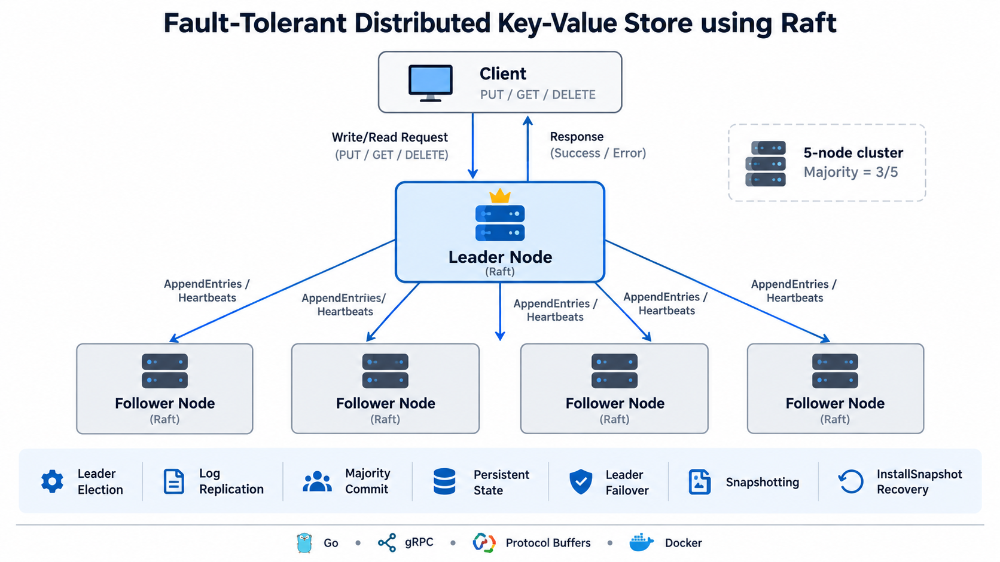

# Fault-Tolerant Distributed Key-Value Store using Raft
[](https://github.com/SatwikaKandula/raft-distributed-kv-store/actions/workflows/ci.yml)
<h2>Architecture Diagram</h2>
<p align="center">
  
</p>
A five-node distributed key-value store written in Go that implements the core Raft consensus protocol over gRPC.

The system supports randomized leader election, replicated logs, majority-based commit, persistent state, crash recovery, automatic leader failover, simulated network partitions, snapshot-based log compaction, follower catch-up, and concurrent client requests.

The final implementation was validated using a five-node Docker cluster with unit tests, race detection, failure and recovery experiments, snapshot recovery, and throughput/latency benchmarks.

---

## Architecture

```text
                         Client
                   PUT / GET / DELETE
                           |
                           v
                    +-------------+
                    | Raft Leader |
                    +------+------+
                           |
                 AppendEntries / Heartbeats
              +------------+------------+
              |            |            |
              v            v            v
          Follower     Follower     Follower ...
```

For every committed write:

```text
Client
   |
   v
Leader appends log entry
   |
   v
Replicate to followers
   |
   v
Majority acknowledges
   |
   v
Leader commits entry
   |
   v
Apply to state machine
   |
   v
Return success to client
```

The default cluster contains five nodes running on ports `5001` through `5005`.

For a five-node cluster:

```text
Majority = 3 nodes
```

A write is considered committed only after it has been replicated to a majority of the cluster.

---

## Implemented Raft Features

- Follower, candidate, and leader states
- Randomized election timeouts
- Majority-based leader election
- RequestVote RPC
- RequestVote log freshness checks
- Periodic leader heartbeats
- AppendEntries RPC
- Previous-log-index and term validation
- Conflicting-log suffix replacement
- Leader `nextIndex` and `matchIndex` tracking
- Majority-based commit advancement
- Current-term commit safety
- Commit-index propagation to followers
- Ordered state-machine application
- `PUT`, `GET`, and `DELETE` gRPC APIs
- Client leader redirects
- Current-term no-op leadership barrier
- Majority confirmation before reads
- Persistent Raft term and vote state
- Persistent uncompacted log suffix
- State reconstruction after restart
- Snapshot-based log compaction
- InstallSnapshot RPC
- Lagging-follower recovery
- Crash recovery
- Automatic leader failover
- Simulated directional network partitions
- Five-node Docker Compose cluster
- Persistent Docker volumes
- Unit tests
- Go race-detector validation
- Concurrent benchmark CLI

---

## Project Layout

```text
cmd/
  node/
    Starts a Raft server

  client/
    PUT / GET / DELETE client

  admin/
    Simulated peer block/unblock commands

  benchmark/
    Concurrent throughput and latency benchmark

internal/raft/
  election.go
  heartbeat.go
  replication.go
  persistence.go
  snapshot.go
  ...

proto/
  raft.proto

Dockerfile
docker-compose.yml
README.md
```

---

## Run Locally

Open five terminals from the repository root:

```bash
go run ./cmd/node 1
go run ./cmd/node 2
go run ./cmd/node 3
go run ./cmd/node 4
go run ./cmd/node 5
```

After the election timeout, one node should become leader.

Example:

```text
Node 2 became Leader for term 1
```

Use the client with:

```bash
go run ./cmd/client localhost:5001 PUT name Satwika
go run ./cmd/client localhost:5003 GET name
go run ./cmd/client localhost:5005 DELETE name
```

A client may contact a follower. If the follower knows the current leader, the client automatically follows the leader redirect.

Example:

```text
Redirecting to leader: node3:5003
Value: Satwika
```

---

## Run the Five-Node Cluster with Docker

Build and start the complete cluster:

```bash
docker compose up --build
```

The cluster contains:

```text
node1 -> port 5001
node2 -> port 5002
node3 -> port 5003
node4 -> port 5004
node5 -> port 5005
```

Each node gets its own persistent Docker volume.

The containers communicate using Docker DNS names such as `node1`, `node2`, etc., instead of `localhost`.

To run the client from inside the Docker network:

```bash
docker compose exec node1 raft-client node2:5002 PUT language Go
docker compose exec node1 raft-client node4:5004 GET language
```

To stop the cluster while keeping persistent data:

```bash
docker compose down
```

To delete all persisted Docker state:

```bash
docker compose down -v
```

---

## Client Operations

### PUT

```bash
docker compose exec node1 raft-client node1:5001 PUT name Satwika
```

Example:

```text
Redirecting to leader: node3:5003
PUT committed successfully
```

### GET

```bash
docker compose exec node1 raft-client node1:5001 GET name
```

Example:

```text
Redirecting to leader: node3:5003
Value: Satwika
```

### DELETE

```bash
docker compose exec node1 raft-client node1:5001 DELETE name
```

Example:

```text
Redirecting to leader: node3:5003
DELETE committed successfully
```

---

## Crash and Leader Failover

Leader failure can be tested by stopping the current leader.

Example:

```bash
docker compose stop node2
```

The remaining nodes detect the missing heartbeat and automatically elect a replacement leader.

Example:

```text
Node 3 became leader
Leader Node 3 sending heartbeat...
```

Previously committed values remain available through the newly elected leader.

Restart the old node with:

```bash
docker compose start node2
```

The restarted node loads its persisted state and catches up through either `AppendEntries` or `InstallSnapshot`, depending on how far behind it is.

---

## Measured Leader Failover

Leader failover was measured in the five-node Docker cluster.

The previous leader stopped at:

```text
2026-10-13T19:07:59.030068048Z
```

The first observed heartbeat from the newly elected leader occurred at:

```text
2026-10-13T19:08:00.746805174Z
```

Observed failover time:

```text
~1.7 seconds
```

This measurement represents the interval between the previous leader stopping and the first logged heartbeat from the newly elected leader.

Previously committed data remained available after failover.

---

## Follower Recovery

Follower recovery was tested by:

1. Stopping a follower.
2. Committing a new entry while the follower was offline.
3. Restarting the follower.
4. Verifying that the missing entry was replicated after recovery.

Example:

```text
PUT recovery working
PUT committed successfully
```

After the follower restarted, its persisted Raft log contained the missing entry:

```text
Type: PUT
Key: recovery
Value: working
```

This verified:

```text
Follower crash
      ->
Cluster continues
      ->
Follower restarts
      ->
Follower catches up
```

---

## Majority Safety

A five-node Raft cluster requires three nodes for a majority.

This was tested by stopping three nodes while keeping the leader alive:

```bash
docker compose stop node1 node4 node5
```

With only two nodes available, the leader could not confirm a new commit:

```text
Failed to reach Raft majority
```

This demonstrates that the leader does not report an entry as committed without quorum.

### Important Raft Detail

If an entry has already been appended to the leader's log but quorum is temporarily unavailable, the request cannot be confirmed as committed at that moment.

However, the entry may still become committed later if the leader regains a majority.

Therefore, an unconfirmed client response does not necessarily mean that the command can never take effect.

This behavior was observed during testing when an entry initially failed to reach quorum but later became committed after the cluster majority was restored.

---

## Network Partition Simulation

Peer blocking is directional.

Example:

```bash
docker compose exec node1 raft-admin node1:5001 block 2
```

To remove the block:

```bash
docker compose exec node1 raft-admin node1:5001 unblock 2
```

For a complete node-isolation experiment, traffic should be blocked in both directions between the target node and the remaining nodes.

---

## Persistence

Each node persists Raft state under:

```text
data/
```

Runtime files are intentionally ignored by Git.

Persistent metadata and the uncompacted log suffix are stored in:

```text
node<ID>.json
```

Snapshot state is stored in:

```text
node<ID>_snapshot.json
```

Persisted Raft metadata includes:

```text
CurrentTerm
VotedFor
CommitIndex
LastApplied
LastIncludedIndex
LastIncludedTerm
Log suffix
```

After restart, the key-value state is reconstructed using:

```text
Snapshot
   +
Committed log suffix
```

---

## Full Cluster Restart Recovery

Persistence was validated using:

```bash
docker compose down
docker compose up -d
```

The persistent Docker volumes were preserved.

After the containers were recreated:

- a new leader was elected,
- persisted Raft state was restored,
- previously committed values remained available.

Example:

```text
Value: working
```

This verified:

```text
Full cluster shutdown
        ->
Persistent state reload
        ->
Leader election
        ->
Committed state recovery
```

---

## Snapshotting

The default snapshot threshold is:

```text
10 newly applied log entries
```

When the threshold is reached, the node:

1. Captures the current key-value state.
2. Records the last included Raft index.
3. Records the last included Raft term.
4. Removes the compacted prefix from the log.
5. Keeps only entries newer than the snapshot.

During testing, Node 1 created a snapshot through Raft index 9.

Example:

```text
Node 1 created snapshot through index 9 (term 3).
Remaining log entries: 0
```

The persisted snapshot contained:

```json
{
  "LastIncludedIndex": 9,
  "LastIncludedTerm": 3,
  "Store": {
    "recovery": "working",
    "snap1": "value1",
    "snap2": "value2",
    "snap3": "value3"
  }
}
```

The regular Raft state then contained only the newer uncompacted log suffix.

---

## InstallSnapshot Recovery

If a follower is far enough behind that the leader has already compacted the required log history, normal `AppendEntries` replication is no longer sufficient.

The leader sends an `InstallSnapshot` RPC instead.

This behavior was directly observed during testing.

Leader output:

```text
Leader Node 1 sending snapshot to Node 4
Leader Node 1 sending snapshot to Node 5
```

Follower output:

```text
Node 4 installed snapshot from Leader 1 through index 9
Node 5 installed snapshot from Leader 1 through index 9
```

This validated:

```text
Leader creates snapshot
        ->
Old log prefix compacted
        ->
Follower requires old history
        ->
Leader sends InstallSnapshot
        ->
Follower installs snapshot
        ->
Normal AppendEntries resumes
```

---

## Tests

Run all tests:

```bash
go test ./...
```

Run the Go race detector:

```bash
go test -race ./...
```

Both passed on the final implementation.

Example:

```text
ok   raft-kv-store/internal/raft
```

No data races were detected.

The race detector is especially important because the implementation uses goroutines, shared node state, election timers, heartbeats, concurrent RPC handlers, replication, and persistence.

---

## Verified Results

The final implementation was validated using a five-node Docker Compose cluster.

| Test | Result |
|---|---|
| Unit tests | Passed |
| Go race detector | Passed |
| Five-node leader election | Passed |
| Heartbeats | Passed |
| PUT | Passed |
| GET | Passed |
| DELETE | Passed |
| Client leader redirect | Passed |
| Majority-based write commit | Passed |
| Leader crash | Passed |
| Automatic re-election | Passed |
| Committed-data preservation | Passed |
| Follower restart | Passed |
| Follower log catch-up | Passed |
| No-majority commit protection | Passed |
| Full-cluster restart recovery | Passed |
| Persistent state recovery | Passed |
| Snapshot creation | Passed |
| Log compaction | Passed |
| InstallSnapshot RPC | Passed |
| Lagging-follower snapshot recovery | Passed |
| Concurrent benchmark | Passed |
| 1,000-request benchmark success rate | 100% |

---

## Benchmark

The benchmark sends concurrent gRPC `PUT` requests directly to the current Raft leader.

Example:

```bash
go run ./cmd/benchmark localhost:5005 1000 50
```

The arguments mean:

```text
localhost:5005
    address of the current Raft leader

1000
    total number of PUT requests

50
    number of concurrent benchmark workers
```

The cluster still contains only five Raft nodes.

The value `1000` represents client requests, not cluster nodes.

---

## How the Benchmark Generates Requests

The benchmark automatically generates unique key-value requests.

Conceptually:

```text
PUT bench-0 0
PUT bench-1 1
PUT bench-2 2
...
PUT bench-999 999
```

For each generated request ID:

```text
Key   = bench-<id>
Value = <id>
```

For example:

```text
id = 47
```

produces:

```text
PUT bench-47 47
```

The 1,000 operations do not need to be entered manually.

---

## Benchmark Concurrency

For:

```bash
go run ./cmd/benchmark localhost:5005 1000 50
```

the benchmark creates:

```text
50 concurrent workers
```

These workers continuously take pending requests until all 1,000 operations have been processed.

Conceptually:

```text
Worker 1  ---- PUT ---->
Worker 2  ---- PUT ---->
Worker 3  ---- PUT ---->
...
Worker 50 ---- PUT ---->
```

When one worker finishes a request, it takes another pending request.

---

## How Latency Is Measured

For every request, the benchmark records the current time immediately before sending the gRPC request.

Conceptually:

```go
start := time.Now()

response, err := client.Put(...)

latency := time.Since(start)
```

The measured latency includes the time from:

```text
Client sends PUT
      ->
Leader receives request
      ->
Leader appends log entry
      ->
Entry replicated
      ->
Majority reached
      ->
Entry committed
      ->
Response returned
```

The benchmark stores the latency of every request.

After all requests finish, the recorded latencies are sorted and used to calculate p50, p95, and p99 latency.

For example:

```text
p50 = 335 ms
```

means approximately 50% of requests finished within 335 ms.

```text
p95 = 389 ms
```

means approximately 95% of requests finished within 389 ms.

---

## How Throughput Is Calculated

Throughput is calculated as:

```text
Successful requests
-------------------
 Total elapsed time
```

For example:

```text
1000 requests / 6.929 seconds
≈ 144.31 requests/sec
```

---

## Benchmark Results

Three benchmark runs were performed using:

```text
1,000 PUT requests
50 concurrent workers
5-node Dockerized Raft cluster
```

| Run | Successful | Throughput | p50 | p95 | p99 |
|---|---:|---:|---:|---:|---:|
| 1 | 1000 / 1000 | 150.57 req/s | 325.259 ms | 345.322 ms | 356.061 ms |
| 2 | 1000 / 1000 | 141.28 req/s | 340.622 ms | 394.448 ms | 406.329 ms |
| 3 | 1000 / 1000 | 144.31 req/s | 334.985 ms | 388.524 ms | 511.193 ms |

Representative median result:

```text
Throughput:   ~144 replicated writes/sec
p50 latency:  ~335 ms
p95 latency:  ~389 ms
p99 latency:  ~406 ms
Success rate: 100%
```

These measurements were collected on a local development machine using Docker.

Performance may vary depending on CPU, memory, Docker configuration, machine load, and runtime conditions.

---

## Benchmark Limitation

The normal client automatically follows leader redirects.

The benchmark currently does not.

Therefore, the current leader address should be passed directly.

For example, if Node 5 is the leader:

```bash
go run ./cmd/benchmark localhost:5005 1000 50
```

Benchmarking a follower may result in:

```text
Successful: 0
```

because the benchmark does not automatically reconnect to the redirected leader.

---

## Measured Performance Summary

```text
Cluster size:        5 nodes
Benchmark requests:  1000 PUTs
Concurrency:         50
Success rate:        100%
Throughput:          ~144 replicated writes/sec
p50 latency:         ~335 ms
p95 latency:         ~389 ms
p99 latency:         ~406 ms
Leader failover:     ~1.7 seconds
```

---

## Git Runtime State

Runtime Raft state under `data/` should not be committed to the repository.

If runtime JSON files were previously tracked:

```bash
git rm --cached data/*.json
git commit -m "Stop tracking runtime Raft state"
```

The `.gitignore` should prevent future runtime state from being committed.

---

## Limitations and Future Improvements

This project is an educational implementation designed to demonstrate Raft consensus and fault-tolerance behavior clearly.

A production-grade distributed key-value store would typically add:

- gRPC connection pooling
- richer conflict-index optimization
- client request IDs
- duplicate-request detection
- idempotency handling
- dynamic cluster membership
- Raft joint consensus
- TLS
- authentication and authorization
- structured logging
- metrics and tracing
- automated fault injection
- longer stress tests
- network-delay simulation
- production-grade persistence engines
- benchmark leader auto-discovery
- read-heavy and mixed-workload benchmarks

---

## Technology Stack

- Go
- gRPC
- Protocol Buffers
- Docker
- Docker Compose
- Raft Consensus
- Concurrent Programming
- Persistent Storage
- Distributed Systems

---

## Project Summary

This project implements a working five-node Raft-based distributed key-value store with:

- Leader election
- Replicated logs
- Majority commit
- PUT / GET / DELETE operations
- Crash recovery
- Leader failover
- Follower catch-up
- Persistent state
- Snapshotting
- Log compaction
- InstallSnapshot recovery
- Network-partition simulation
- Concurrent benchmarking

The final system was tested under node failures, full-cluster restarts, temporary loss of quorum, follower lag, snapshot recovery, and concurrent write workloads.